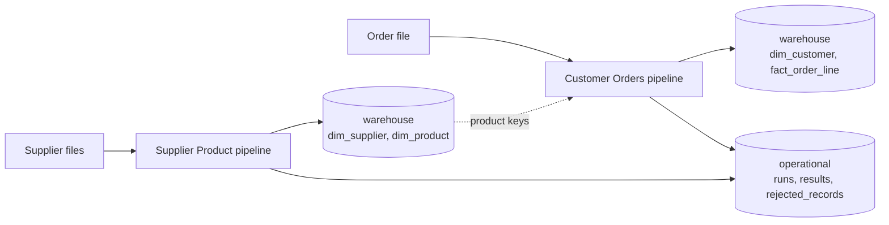
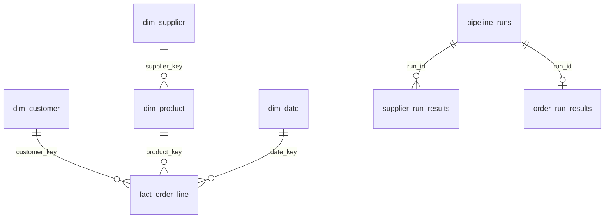

# AGPP Data Platform

[](https://github.com/yaya-soumah/agpp-data-platform/actions/workflows/ci.yml)

A production-style data platform for the fictitious company AGPP, built as
an engineering portfolio. Three pipelines (Supplier Product, Customer
Orders, Inventory) share one platform, one warehouse and one set of
engineering standards.

```
Supplier Product ──┐
Customer Orders ───┼──> Data Warehouse
Inventory ─────────┘
```

> **Status:** under active development. See the pull request history for
> progress.

## Principles

Each pipeline follows the same lifecycle: **extract → validate →
transform → load**. Business logic never orchestrates itself, nothing
environment-specific lives in code, and re-running a pipeline with the
same input never creates inconsistent data. The reasoning behind each
choice is recorded in [`docs/adr/`](docs/adr/README.md).

## Architecture

Every pipeline follows the same lifecycle. The Supplier Product pipeline is
implemented end to end.


- **Isolation.** Supplier Product processes each supplier independently; Customer Orders processes one file per run; one
  failing supplier never stops the others.
- **Atomic loading.** One transaction per supplier; a failure leaves no
  half-written data.
- **Idempotent.** Running the pipeline again on the same files writes nothing,
  and an older file never overwrites newer data.
- **Observable.** Every run is recorded with its per-supplier result, and
  every rejected row is stored with its source line and reasons.
- **Late reference data.** An order line whose product is not in the catalog yet is loaded against the unknown product and corrected on the next run.



The reasoning behind each choice is in the
[architecture decision records](docs/adr/README.md).

## Requirements

- Python 3.13.1 or newer
- [uv](https://docs.astral.sh/uv/)

## Getting started

```bash
git clone https://github.com/yaya-soumah/agpp-data-platform.git
cd agpp-data-platform
uv sync
cp .env_example .env      # then edit .env with real values
uv run agpp check-config
```

## Local services

PostgreSQL runs through Docker Compose and reads its credentials from `.env`:

```bash
docker compose up -d      # start
docker compose ps         # check health
docker compose down       # stop (data is kept)
docker compose down -v    # stop and delete data
```
## Database and migrations

The database has two schemas: `operational` (run history, rejected records,
migration bookkeeping) and `warehouse` (the dimensional model). See
[ADR-0008](docs/adr/0008-warehouse-separation-and-database-access.md).

Schema changes are versioned SQL files in `sql/migrations/`, named
`NNNN_description.sql`. Apply them with:

```bash
uv run agpp migrate
```

Each migration runs in one transaction and is recorded with a checksum.
Never edit a migration that has been applied: add a new one instead. A
modified or missing applied migration stops the run.

### Loading data

Warehouse conventions (keys, audit columns, unknown members, Type 1 history)
are in [ADR-0009](docs/adr/0009-warehouse-modeling-conventions.md). Loads go
through `agpp.shared.database.warehouse.upsert`, which writes only rows whose
values changed, so running a pipeline twice on the same input leaves the data
unchanged.

## Configuration

Settings come from `config/base.yaml`, overlaid by `config/<environment>.yaml`.
The environment is chosen by `AGPP_ENV` (`development`, `testing` or
`production`); it has no default. YAML values may reference environment
variables as `${NAME}` (required) or `${NAME:-default}`. Secrets live only in
`.env` or the process environment, never in YAML. See
[ADR-0005](docs/adr/0005-configuration-first-and-environment-variables.md).

```python
from pathlib import Path

from agpp.shared.configuration.service import load_config

config = load_config(Path("config"), env_file=Path(".env"))
print(config.database.host)
```

## Logging

Logging is configured once at startup from the `logging` section of the
configuration (`level`, `format`, optional `file`). Development logs
human-readable lines to stderr and to `logs/agpp.log`; production writes JSON
lines to stderr. Pipelines log through
`get_pipeline_logger(pipeline, run_id)` so every record carries its run
context. See [ADR-0006](docs/adr/0006-logging.md).

## Command line

```bash
uv run agpp --help
uv run agpp check-config    # load and validate configuration
```

Exit codes: `0` success, `1` platform error during a command, `2` invalid
configuration. Run from the repository root, or pass `--config-dir` and
`--env-file`.

## Sample data

Supplier files for the Supplier Product pipeline can be generated locally:

```bash
uv run agpp generate-sample-data --rows 200 --bad-ratio 0.05 --seed 42
```

Files are written where `config/pipelines/supplier_product.yaml` says (by
default under `data/incoming/supplier_product/`). The output is reproducible
for a given seed. A share of rows is deliberately defective, so validation
and the quality gate (`max_reject_ratio`) can be demonstrated; raise
`--bad-ratio` above 0.10 to see a run fail the gate. See
[ADR-0010](docs/adr/0010-supplier-product-pipeline-contract.md).

## Supplier Product extraction

```bash
uv run agpp extract-supplier-products
```

Reads every supplier source from `config/pipelines/supplier_product.yaml` and
logs the rows and columns found per supplier. Unreadable sources are retried
(`extraction.max_attempts`, `extraction.initial_delay_seconds`); a supplier
that still fails is reported while the others continue, and the command exits
with status 1. See [ADR-0011](docs/adr/0011-extraction-design.md).

## Supplier Product validation

```bash
uv run agpp validate-supplier-products
```

Extracts every supplier file, then checks it in order: schema, row parsing,
business rules from `config/pipelines/supplier_product.yaml`, duplicates and
the quality gate (`quality.max_reject_ratio`). Rejected rows are counted per
check, with the source line and every reason, and a supplier whose file is too
broken is reported and skipped while the others continue. The command exits
with status 1 if any supplier failed. See
[ADR-0012](docs/adr/0012-validation-design.md).

## Running the Supplier Product pipeline

```bash
uv run agpp migrate                 # once, and after pulling new migrations
uv run agpp run-supplier-product
```

Runs extraction, validation, transformation and loading for every supplier in
`config/pipelines/supplier_product.yaml`. Each supplier is loaded in one
transaction, so a failure leaves no half-written data, and a failing supplier
does not affect the others. Running it again on the same files changes
nothing, and an older file never overwrites newer data. Every run and its
per-supplier result is recorded in `operational.pipeline_runs` and
`operational.supplier_run_results`; rejected rows are stored in
`operational.rejected_records`. The command exits with status 1 unless every
supplier loaded. See [ADR-0014](docs/adr/0014-loading-design.md).

## Running the Customer Orders pipeline

Orders refer to products, so run the Supplier Product pipeline first (a
different order is safe, but those lines are loaded as "unknown product").

```bash
uv run agpp generate-sample-orders --lines 300   # needs products in the warehouse
uv run agpp run-customer-orders
```

The command extracts, validates, transforms and loads the order file from
`config/pipelines/customer_orders.yaml` in one transaction; any failure fails
the run, which is recorded with its stage in `operational.order_run_results`.
Running it again on the same file changes nothing, and an older update never
overwrites a newer one. See [ADR-0016](docs/adr/0016-customer-orders-pipeline-contract.md).

## Running in Docker

```bash
docker compose up -d                                   # PostgreSQL
docker compose run --rm app migrate
docker compose run --rm app generate-sample-data --rows 100
docker compose run --rm app run-supplier-product
```

The image runs as a non-root user with the production configuration (JSON
logs); credentials come from the environment, never from the image. See
[ADR-0015](docs/adr/0015-containerization.md).

## Quality gates

Every change must pass all four checks (enforced in CI):

```bash
uv run pytest
uv run ruff check .
uv run ruff format --check .
uv run mypy
uv run lint-imports
```
lint-imports` enforces the architecture boundaries
CI runs two jobs on every pull request: `quality` (the four gates above) and
`integration` (`pytest -m integration` against a PostgreSQL service
container), so the idempotency and rollback tests are verified on every change.

## Testing

`uv run pytest` runs unit tests and enforces a minimum of 85% branch
coverage. Integration tests need Docker services and are excluded by
default:

```bash
docker compose up -d
uv run pytest -m integration --no-cov
```

See [ADR-0003](docs/adr/0003-testing-strategy.md).

Optional local hooks for fast feedback before each commit:

```bash
uv run pre-commit install
```

## Repository layout

| Path | Purpose |
|---|---|
| `src/agpp/pipelines/` | One package per pipeline, each owning its business logic |
| `src/agpp/shared/` | Generic infrastructure: configuration, logging, exceptions, database, retry, dates |
| `config/` | Environment YAML and `pipelines/<name>.yaml` (no secrets) |
| `sql/migrations` | Versioned SQL migrations |
| `Dockerfile`, `docker-compose.yml` | Container image and local services |
| `tests/` | Unit and integration tests |
| `docs/` | Architecture decision records and documentation |
| `data/` | Local sample and generated data (not committed) |

## Documentation

- [Architecture decision records](docs/adr/)
