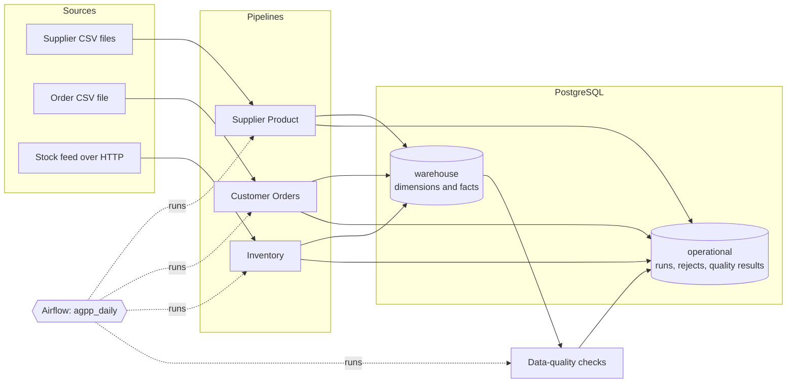
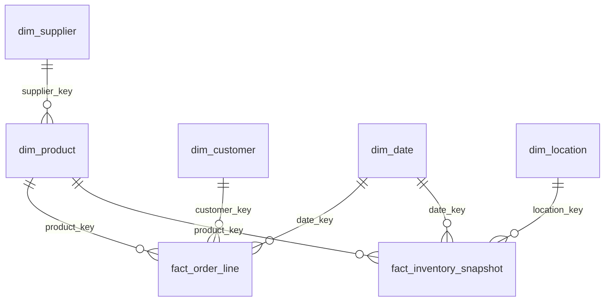
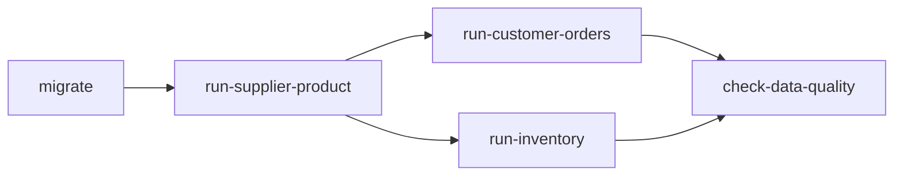

# AGPP Data Platform

[](https://github.com/yaya-soumah/agpp-data-platform/actions/workflows/ci.yml)
[](LICENSE)

A production-style data platform for a fictitious company, built as an engineering
portfolio. Three pipelines (supplier products, customer orders, stock levels) load one
PostgreSQL warehouse, Airflow runs them every day, and a configurable data-quality layer
measures the result. It is tested, containerized and documented the way a team would ship
it: every significant choice is recorded in an
[architecture decision record](docs/adr/README.md).

## What it does

- **Supplier Product** loads product catalogs from several supplier CSV files into
  `dim_supplier` and `dim_product`. Each supplier is validated and loaded in its own
  transaction, so one bad file never stops the others.
- **Customer Orders** loads an order file into `dim_customer` and `fact_order_line`. An order
  line whose product is not in the catalog yet is loaded against an unknown member and
  corrected on the next run.
- **Inventory** loads a paginated JSON stock feed over HTTP as a periodic snapshot into
  `dim_location` and `fact_inventory_snapshot`, keeping one snapshot per day as history.
- **Orchestration**: an Airflow DAG runs migrations, the three pipelines in dependency
  order and the quality checks every day.
- **Data quality**: nine checks written as SQL in a configuration file measure freshness,
  unknown-member share, coverage and the health of the latest runs.

Every pipeline follows the same lifecycle: **extract, validate, transform, load**.
Rejected rows are stored with their source line and reasons, and running a pipeline twice on
the same input writes nothing.

## Architecture



The warehouse is a small star schema. Orders and inventory both join to the product
dimension that the Supplier Product pipeline owns, but no pipeline imports another:
they meet only in the data.



### The daily workflow



Orders and inventory run in parallel after the supplier products. If one pipeline fails,
nothing half-written reaches the warehouse, and the quality task still runs (it is
configured to run even after a failure) and reports it.

## Engineering highlights

| Concern | What was done | Decision |
|---|---|---|
| Idempotent loads | Only changed rows are written; a rerun writes nothing and older data never overwrites newer | [ADR-0014](docs/adr/0014-loading-design.md) |
| Late reference data | Unknown products load against an unknown member and heal on a later run | [ADR-0009](docs/adr/0009-warehouse-modeling-conventions.md) |
| Validation | Schema, parsing, business rules and duplicate checks, a quality gate, rejects stored with reasons | [ADR-0012](docs/adr/0012-validation-design.md) |
| Configuration | Layered YAML plus environment variables; secrets never in code or YAML | [ADR-0005](docs/adr/0005-configuration-first-and-environment-variables.md) |
| Architecture enforced | `import-linter` contracts keep layers and pipeline independence; shared code only after a second user | [ADR-0017](docs/adr/0017-shared-building-blocks.md) |
| Quality gates | pytest (620 unit tests, 85% branch coverage), ruff, strict mypy, import-linter, all required in CI | [ADR-0002](docs/adr/0002-quality-gates-and-ci.md) |
| Real-database tests | 193 integration tests against PostgreSQL and a real HTTP server, in their own CI job | [ADR-0003](docs/adr/0003-testing-strategy.md) |
| Containers | Multi-stage, non-root image; Docker Compose for the database and a mock stock feed | [ADR-0015](docs/adr/0015-containerization.md) |
| Orchestration | Airflow kept out of the project's dependencies; tasks run the same CLI in the same image | [ADR-0019](docs/adr/0019-orchestration-with-airflow.md) |
| Data quality | Checks are SQL in configuration, run read-only, with history and a current-state view | [ADR-0020](docs/adr/0020-data-quality-metrics.md) |

## Quick start

You need Docker, [uv](https://docs.astral.sh/uv/) and Python 3.12.

```bash
git clone https://github.com/yaya-soumah/agpp-data-platform.git
cd agpp-data-platform
uv sync
cp .env_example .env                    # then set the POSTGRES_* values
docker compose up -d                    # PostgreSQL
uv run agpp migrate
uv run agpp generate-sample-data --rows 100
uv run agpp run-supplier-product
uv run agpp generate-sample-orders --lines 300
uv run agpp run-customer-orders
uv run agpp serve-sample-inventory      # in a second terminal, leave it running
uv run agpp run-inventory
uv run agpp check-data-quality
```

Run any pipeline command a second time and it changes nothing. To see the daily
workflow in Airflow, follow [`orchestration/airflow/`](orchestration/airflow/README.md).

## Tech stack

Python 3.12 and [uv](https://docs.astral.sh/uv/), Pydantic, PostgreSQL 16 with psycopg,
httpx, Docker and Docker Compose, Apache Airflow 3.4, pytest, ruff, mypy, import-linter,
pre-commit and GitHub Actions.

## Status and what comes next

All three pipelines, the orchestration and the quality layer are complete and tested. Known
limits, stated plainly:

- The data is synthetic; thresholds in the quality catalog are tuned for it.
- Supplier Product reads CSV files only. An API source would exercise its extractor registry.
- The CLI takes no date argument, so the DAG cannot backfill by logical date
  ([ADR-0019](docs/adr/0019-orchestration-with-airflow.md)).
- Secrets come from environment variables; a secrets backend belongs to a real deployment.
- The Airflow stack is for local use. Spark is not used because these volumes do not need
  it; it would be evaluated when they do.

Progress and decisions are in the [pull request history](https://github.com/yaya-soumah/agpp-data-platform/pulls?q=is%3Apr+is%3Aclosed)
and the [ADR index](docs/adr/README.md).

---

The rest of this document is reference material: setup, configuration and per-pipeline
instructions.

## Requirements

- Python 3.12 or newer
- [uv](https://docs.astral.sh/uv/)

## Getting started

```bash
git clone https://github.com/yaya-soumah/agpp-data-platform.git
cd agpp-data-platform
uv sync
cp .env_example .env      # then edit .env with real values
uv run agpp check-config
```

## Local services

PostgreSQL runs through Docker Compose and reads its credentials from `.env`:

```bash
docker compose up -d      # start
docker compose ps         # check health
docker compose down       # stop (data is kept)
docker compose down -v    # stop and delete data
```
## Database and migrations

The database has two schemas: `operational` (run history, rejected records,
migration bookkeeping) and `warehouse` (the dimensional model). See
[ADR-0008](docs/adr/0008-warehouse-separation-and-database-access.md).

Schema changes are versioned SQL files in `sql/migrations/`, named
`NNNN_description.sql`. Apply them with:

```bash
uv run agpp migrate
```

Each migration runs in one transaction and is recorded with a checksum.
Never edit a migration that has been applied: add a new one instead. A
modified or missing applied migration stops the run.

### Loading data

Warehouse conventions (keys, audit columns, unknown members, Type 1 history)
are in [ADR-0009](docs/adr/0009-warehouse-modeling-conventions.md). Loads go
through `agpp.shared.database.warehouse.upsert`, which writes only rows whose
values changed, so running a pipeline twice on the same input leaves the data
unchanged.

## Configuration

Settings come from `config/base.yaml`, overlaid by `config/<environment>.yaml`.
The environment is chosen by `AGPP_ENV` (`development`, `testing` or
`production`); it has no default. YAML values may reference environment
variables as `${NAME}` (required) or `${NAME:-default}`. Secrets live only in
`.env` or the process environment, never in YAML. See
[ADR-0005](docs/adr/0005-configuration-first-and-environment-variables.md).

```python
from pathlib import Path

from agpp.shared.configuration.service import load_config

config = load_config(Path("config"), env_file=Path(".env"))
print(config.database.host)
```

## Logging

Logging is configured once at startup from the `logging` section of the
configuration (`level`, `format`, optional `file`). Development logs
human-readable lines to stderr and to `logs/agpp.log`; production writes JSON
lines to stderr. Pipelines log through
`get_pipeline_logger(pipeline, run_id)` so every record carries its run
context. See [ADR-0006](docs/adr/0006-logging.md).

## Command line

```bash
uv run agpp --help
uv run agpp check-config    # load and validate configuration
```

Exit codes: `0` success, `1` platform error during a command, `2` invalid
configuration. Run from the repository root, or pass `--config-dir` and
`--env-file`.

## Sample data

Supplier files for the Supplier Product pipeline can be generated locally:

```bash
uv run agpp generate-sample-data --rows 200 --bad-ratio 0.05 --seed 42
```

Files are written where `config/pipelines/supplier_product.yaml` says (by
default under `data/incoming/supplier_product/`). The output is reproducible
for a given seed. A share of rows is deliberately defective, so validation
and the quality gate (`max_reject_ratio`) can be demonstrated; raise
`--bad-ratio` above 0.10 to see a run fail the gate. See
[ADR-0010](docs/adr/0010-supplier-product-pipeline-contract.md).

## Supplier Product extraction

```bash
uv run agpp extract-supplier-products
```

Reads every supplier source from `config/pipelines/supplier_product.yaml` and
logs the rows and columns found per supplier. Unreadable sources are retried
(`extraction.max_attempts`, `extraction.initial_delay_seconds`); a supplier
that still fails is reported while the others continue, and the command exits
with status 1. See [ADR-0011](docs/adr/0011-extraction-design.md).

## Supplier Product validation

```bash
uv run agpp validate-supplier-products
```

Extracts every supplier file, then checks it in order: schema, row parsing,
business rules from `config/pipelines/supplier_product.yaml`, duplicates and
the quality gate (`quality.max_reject_ratio`). Rejected rows are counted per
check, with the source line and every reason, and a supplier whose file is too
broken is reported and skipped while the others continue. The command exits
with status 1 if any supplier failed. See
[ADR-0012](docs/adr/0012-validation-design.md).

## Running the Supplier Product pipeline

```bash
uv run agpp migrate                 # once, and after pulling new migrations
uv run agpp run-supplier-product
```

Runs extraction, validation, transformation and loading for every supplier in
`config/pipelines/supplier_product.yaml`. Each supplier is loaded in one
transaction, so a failure leaves no half-written data, and a failing supplier
does not affect the others. Running it again on the same files changes
nothing, and an older file never overwrites newer data. Every run and its
per-supplier result is recorded in `operational.pipeline_runs` and
`operational.supplier_run_results`; rejected rows are stored in
`operational.rejected_records`. The command exits with status 1 unless every
supplier loaded. See [ADR-0014](docs/adr/0014-loading-design.md).

## Running the Customer Orders pipeline

Orders refer to products, so run the Supplier Product pipeline first (a
different order is safe, but those lines are loaded as "unknown product").

```bash
uv run agpp generate-sample-orders --lines 300   # needs products in the warehouse
uv run agpp run-customer-orders
```

The command extracts, validates, transforms and loads the order file from
`config/pipelines/customer_orders.yaml` in one transaction; any failure fails
the run, which is recorded with its stage in `operational.order_run_results`.
Running it again on the same file changes nothing, and an older update never
overwrites a newer one. See [ADR-0016](docs/adr/0016-customer-orders-pipeline-contract.md).

## Running the Inventory pipeline

The feed is a paginated JSON API (`config/pipelines/inventory.yaml`; address and token come
from `INVENTORY_API_URL` and `INVENTORY_API_TOKEN`). For development a local feed built
from the products in your warehouse can be served:

```bash
uv run agpp serve-sample-inventory      # terminal 1, leave running
uv run agpp run-inventory               # terminal 2
```

Each run loads a periodic snapshot: running again on the same feed changes nothing, a later
snapshot on the same day replaces that day's rows, an older late one never overwrites a newer
one, and a new day adds rows, which is the history. A stale, future or unreadable snapshot, a
broken feed or a failed quality gate fails the run with its stage recorded in
`operational.inventory_run_results`. See [ADR-0018](docs/adr/0018-inventory-pipeline-contract.md).

## Running in Docker

```bash
docker compose up -d                                   # PostgreSQL
docker compose run --rm app migrate
docker compose run --rm app generate-sample-data --rows 100
docker compose run --rm app run-supplier-product
docker compose up -d feed        # serves a synthetic stock feed built from the products
docker compose run --rm app run-inventory
```

The image runs as a non-root user with the production configuration (JSON
logs); credentials come from the environment, never from the image. See
[ADR-0015](docs/adr/0015-containerization.md).

## Orchestration

Airflow runs the three pipelines daily as one workflow, `agpp_daily`:


Each task runs one `agpp` command in the AGPP container image, so Airflow never
imports pipeline code and is not a project dependency. Orders and inventory run
in parallel after supplier products, and a failed supplier run stops them. See
[`orchestration/airflow/`](orchestration/airflow/README.md) and
[ADR-0019](docs/adr/0019-orchestration-with-airflow.md).
A last task measures the state of the warehouse; it runs even when a pipeline failed.

## Data quality

Pipelines protect themselves from bad input (rejected rows, quality gates). The platform
also measures the state of the warehouse after loading:

```bash
uv run agpp check-data-quality
```

Checks are SQL queries in `config/pipelines/data_quality.yaml`, each with `warn` and `fail`
thresholds, so adding a check is a configuration change. Every check runs in a read-only
transaction; a broken check is reported and the others continue. Results are stored per run in
`operational.quality_check_results` (history) and `operational.quality_latest` (current
state). The command exits 1 when a check fails or cannot run. See
[ADR-0020](docs/adr/0020-data-quality-metrics.md).

| Check | Measures |
|---|---|
| `order_lines_unknown_product_share`, `inventory_unknown_product_share` | Rows loaded against the unknown product |
| `inventory_snapshot_age_hours`, `product_catalog_age_hours` | Freshness |
| `products_without_stock_share`, `products_never_ordered_share` | Coverage between dimensions and facts |
| `products_with_invalid_price` | An invariant that should be impossible |
| `order_last_run_failed`, `inventory_last_run_failed` | Health of the latest runs |

## Quality gates

Every change must pass all four checks (enforced in CI):

```bash
uv run pytest
uv run ruff check .
uv run ruff format --check .
uv run mypy
uv run lint-imports   # enforces the architecture boundaries
```
CI runs four jobs on every pull request: `quality` (the five checks above) and
`integration` (`pytest -m integration` against a PostgreSQL service
container, so the idempotency and rollback tests are verified on every change), `image` (Docker
build checks) and `orchestration` (Airflow DAG structure tests).

## Testing

`uv run pytest` runs unit tests and enforces a minimum of 85% branch
coverage. Integration tests need Docker services and are excluded by
default:

```bash
docker compose up -d
uv run pytest -m integration --no-cov
```

See [ADR-0003](docs/adr/0003-testing-strategy.md).

Optional local hooks for fast feedback before each commit:

```bash
uv run pre-commit install
```

## Repository layout

| Path | Purpose |
|---|---|
| `src/agpp/pipelines/` | One package per pipeline (`supplier_product`, `customer_orders`, `inventory`), each with `extraction`, `validation`, `transformation`, `loading` and a `service` |
| `src/agpp/shared/` | Generic infrastructure: configuration, logging, exceptions, database, retry, dates |
| `config/` | Environment YAML and `pipelines/<name>.yaml` (no secrets) |
| `sql/migrations` | Versioned SQL migrations |
| `Dockerfile`, `docker-compose.yml` | Container image and local services |
| `orchestration/airflow/` | Airflow DAG, image and compose file (isolated from the project) |
| `tests/` | Unit and integration tests |
| `docs/` | Architecture decision records and documentation |
| `data/` | Local sample and generated data (not committed) |

## Documentation

- [Architecture decision records](docs/adr/)
- [Orchestration with Airflow](orchestration/airflow/README.md)

## License

Released under the [MIT License](LICENSE).
